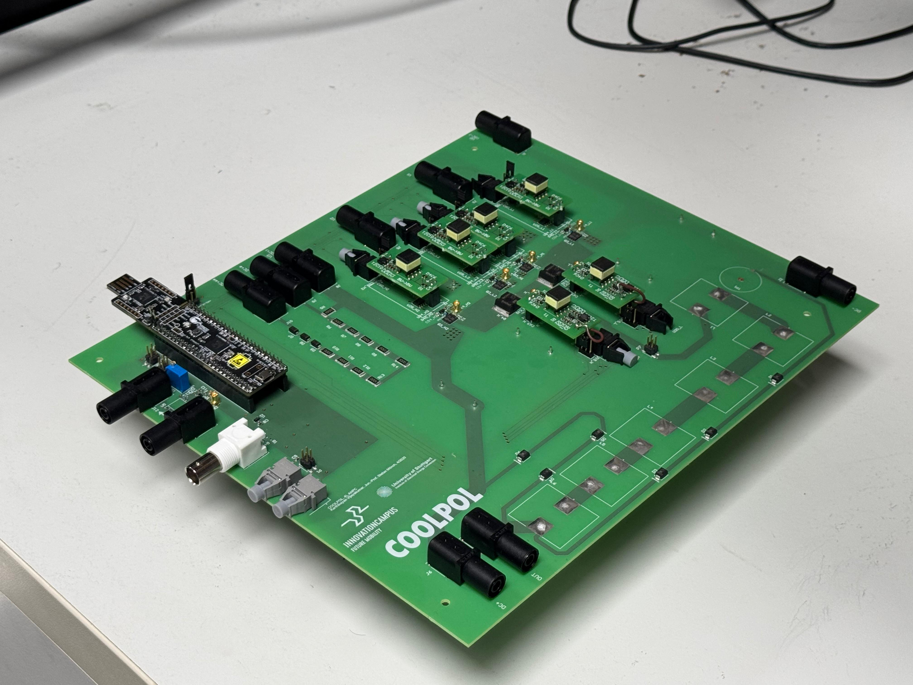
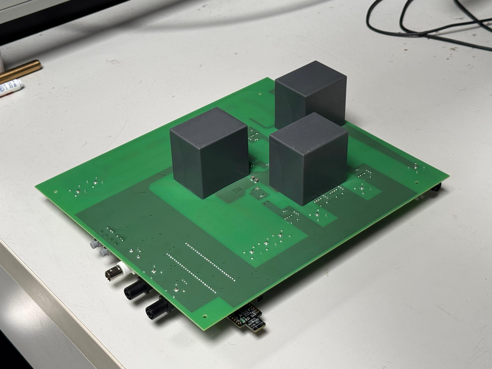
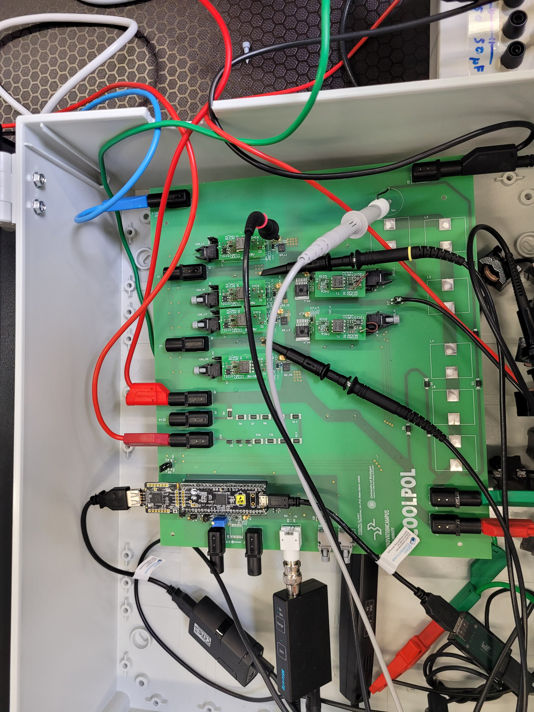

<h2 align="center">Design of 4L ANPC converter</h2>

📄 [View RP Report (PDF)](RP_Report.pdf)

**Design | Simulation | PCB Development | Hardware Implementation | Experimental Validation**

## Project Overview

Designed, simulated and experimentally validated a hybrid GaN/SiC four-level Active Neutral Point Clamped (ANPC) converter, focusing on high-efficiency power conversion, reduced switching losses, Zero Voltage Switching (ZVS) and low-parasitic PCB implementation.

## Key Technical Contributions

- **Power Stage Design:** Evaluated 4-Level DC-NPC, ANPC and π-type NPC topologies; implemented a hybrid ANPC architecture using 4 × GS-065-011-1-L GaN HEMTs (650 V) and 2 × IMBG120R116M2H SiC MOSFETs (1.2 kV).

- **Gate Driver Design:** Developed isolated gate-driver circuits using FAN3111ESX gate-driver ICs and MAX22420FASA+ digital isolators, with independent turn-on/turn-off gate resistances and BAS40 Schottky diodes.

- **PCB Design:** Designed a compact 2-layer power electronics PCB with vertical power-loop routing, optimized component placement, reduced gate-loop and commutation-loop inductance, and high-voltage isolation.

- **Control Development:** Developed two-level hysteresis current control and four-level switching logic in PLECS. Implemented the switching logic in Verilog-A on a Cypress PSoC 5LP-based controller.

- **Experimental Validation:** Characterized 2-level and 4-level converter operation, optimized switching deadtimes, verified ZVS transitions and evaluated converter efficiency using laboratory measurements.

## Key Experimental Results

- **98.84% converter efficiency** in four-level operation, compared with 98.03% in two-level operation.
- **41.63% reduction in converter power losses** compared with two-level operation.
- Experimentally optimized switching deadtimes to achieve smooth voltage transitions and minimize switching-related losses.

## Tools & Technologies

- **Simulation:** PLECS, MATLAB
- **Control & Programming:** Verilog-A, Cypress PSoC 5LP, PSoC Creator
- **PCB Design:** Altium Designer
- **Laboratory Setup & Experimental Work:** Yokogawa WT1804E Power Analyzer, Digital Oscilloscope, Tektronix TPP1000 and TPP0850 Voltage Probes, Testec Differential Probe, Keysight 10076C Probe, Tektronix TCPA300 Current Amplifier, TCP305 Current Probe, MCR1101-5-5 Hall-Effect Sensor, DC Power Supply, Custom RL Load, Litz-Wire Inductor, PCB Soldering, Hardware Assembly and Prototype Bring-Up

<strong>Designed PCB

  
  

<strong>Experimental Setup

  

